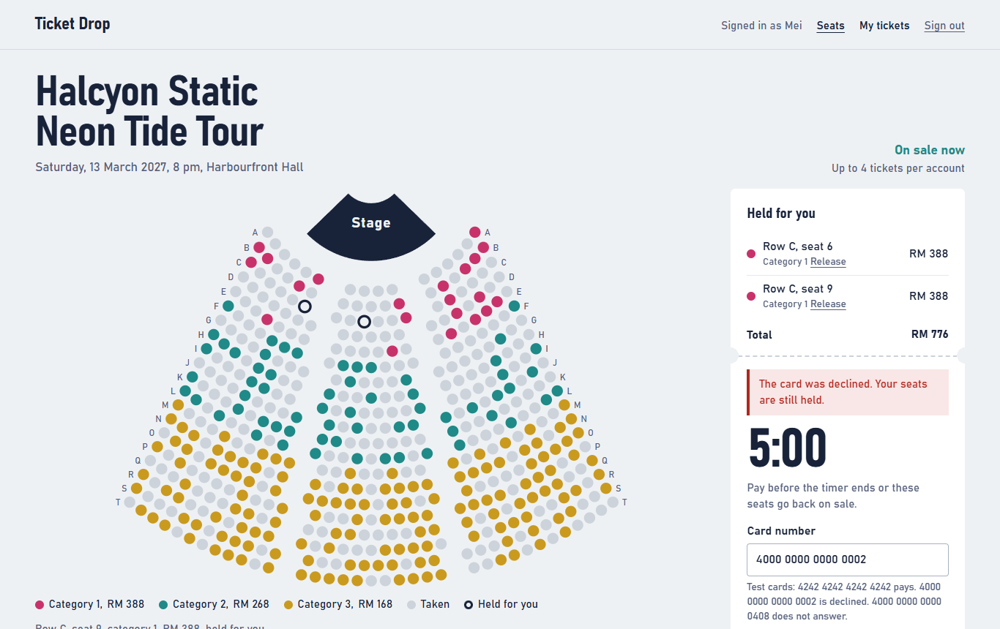
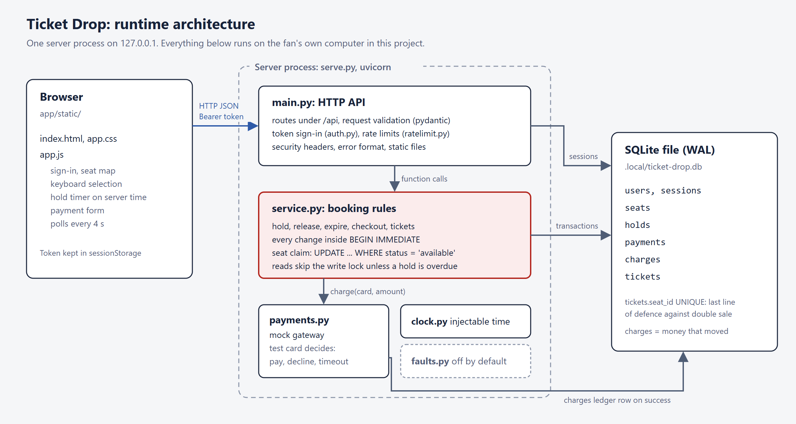
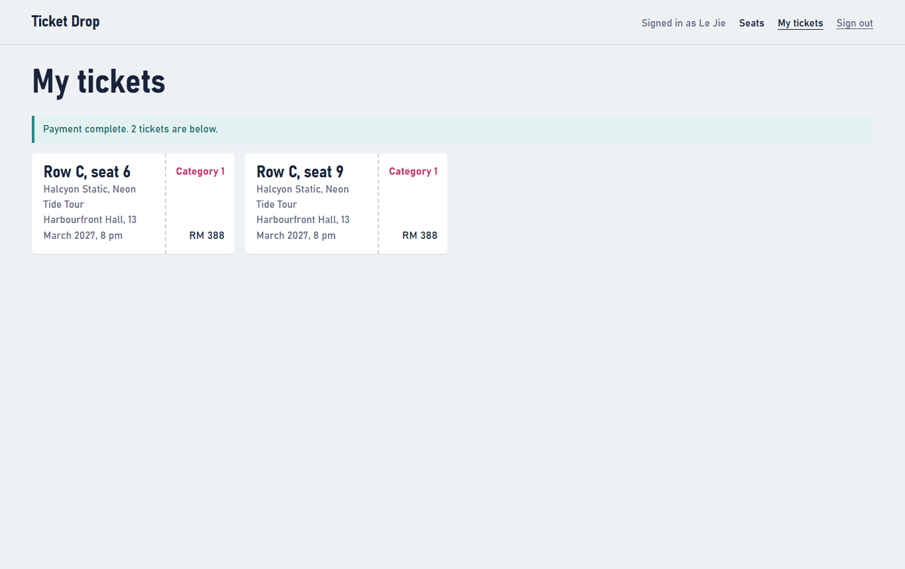
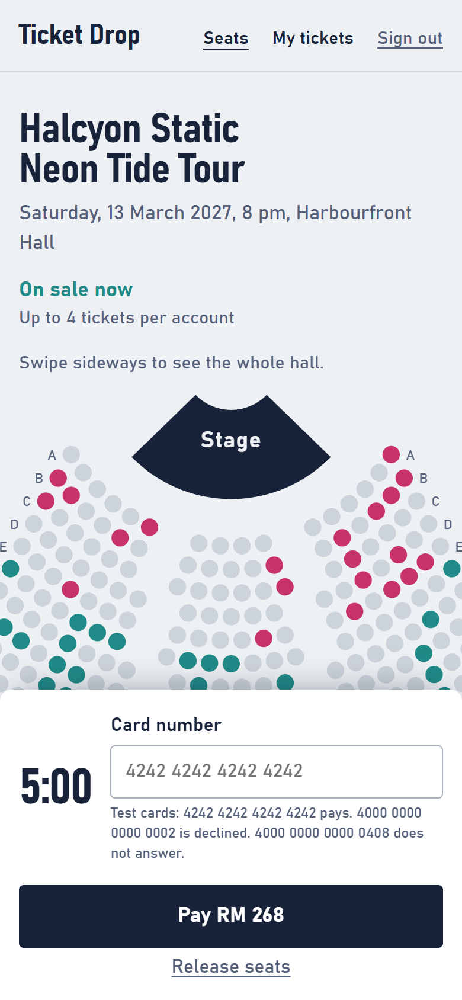

# Ticket Drop

A concert ticket sale app built to be tested: seat holds, payment failure, concurrency, load and security.



## The question

When hundreds of fans press Buy in the same second, can anyone be sold the same seat twice, lose the seats they were holding, or pay without getting tickets?

Ticket Drop is small on purpose: one concert, 510 seats, four tickets per account, a five-minute hold and a mock payment gateway. The work is in specifying that behaviour precisely and proving it, under normal use, at exact time boundaries, under parallel requests, under a burst of 200 fans, and against an attacker with an account of their own.

## How it works



One server process owns one SQLite file. Every change to seats, holds and payments runs inside `BEGIN IMMEDIATE`, so only one writer acts at a time, and a seat is claimed with `UPDATE ... WHERE status = 'available'`, so a seat someone else already took is refused rather than overwritten. A `UNIQUE` constraint on each ticket's seat is the last line of defence against selling a seat twice.

Checkout calls the slow payment gateway with no database lock held, and a repeated request with the same idempotency key returns the first answer instead of charging again. The [checkout sequence](docs/DESIGN.md#3-checkout) walks through it step by step.

## What the evidence shows

<!-- RESULTS:START -->
| Check | Result |
|---|---|
| Automated tests (API, security, concurrency, browser) | 197 passed |
| 50 fans requesting one seat at the same instant | exactly 1 hold, 49 refused |
| 200-fan burst at the sale opening, 60 s | 0 server errors, 0 seats sold twice, money charged = ticket value; median 2.9 s, p95 4.7 s on one laptop ([DEF-002](docs/DEFECTS.md)) |
| Static scans | bandit: 2 low findings, triaged; pip-audit: 0 known vulnerabilities in 84 packages |
| Ten planted bugs, scripted suite | 8 caught; the 2 gaps were then closed with one new test and one tightened assertion ([fault report](evidence/faults/REPORT.md)) |
| Same bugs, random explorer and local AI explorer (3 runs each) | random 2 of 10, local llama3.2 1 of 10; 0 false alarms |
| Highest-severity real defect | charged but no tickets after a failed settle step; found by a separate review agent that never saw the author's reasoning, fixed, regression test proven to fail on the old code |
<!-- RESULTS:END -->

Latency figures are from one laptop running both the server and the load generator. They are observations, not a service level. See [the verification record](docs/VERIFICATION.md) for what each result does and does not show.

## How it was tested

| Level | Tool | Example |
|---|---|---|
| Rules on exact boundaries | pytest, frozen clock | the hold is valid at 299 999 ms and ends at 300 000 ms |
| One account attacking another | pytest | reading another fan's ticket answers exactly like a missing one |
| Real parallel requests | threads behind a barrier, live server | five simultaneous Pay clicks charge once |
| The fan's journeys | Playwright on Chrome | keyboard-only seat selection; the phone layout |
| A burst at the sale opening | Locust, then a database integrity check | 200 fans in one second |
| Static security | bandit, pip-audit | dependency vulnerabilities |
| Generated test data | local llama3.2, judged by a fixed rule | the model proposes inputs; it never decides the expected result |
| Exploratory testing | local llama3.2 or random choice, shared rule checks | which one finds planted bugs |
| Testing the tests | ten seeded faults, planted by an agent that never saw the tests | which approach catches which bug |

## Run it

Windows, Python 3.12 and Google Chrome.

```powershell
git clone https://github.com/lejie710/ticket-drop.git
cd ticket-drop
py -3.12 -m venv .venv
.\.venv\Scripts\python.exe -m pip install -r requirements-lock.txt
.\.venv\Scripts\python.exe serve.py --sample-sales 0.55
```

Open http://127.0.0.1:8000 and sign in as `lejie`, `arjun`, `siti` or `wei`, password `demo-pass`. Test cards: `4242 4242 4242 4242` pays, `4000 0000 0000 0002` is declined, `4000 0000 0000 0408` times out. `--sample-sales` marks about half the seats as sold to sample accounts so the map looks like a sale in progress.

## What it looks like

<p>
  
  
</p>

The image at the top shows a declined card: the seats stay held for the rest of the five minutes. After a successful payment, each seat becomes a ticket under My tickets. On a phone, the map scrolls sideways and the payment panel docks at the bottom of the screen. The [walkthrough](docs/WALKTHROUGH.md) goes through every screen in order.

## Test it

```powershell
.\.venv\Scripts\python.exe -m pytest                   # everything, about three minutes
.\.venv\Scripts\python.exe tools\run_load_test.py      # the 200-fan burst
.\.venv\Scripts\python.exe tools\security_scan.py      # bandit and pip-audit
```

The AI tools need [Ollama](https://ollama.com) with `llama3.2`; nothing else does. All commands are in [OPERATIONS.md](docs/OPERATIONS.md).

## Read more

| Document | Contents |
|---|---|
| [Walkthrough](docs/WALKTHROUGH.md) | Every screen of the app in order, with what each one does |
| [Brief](docs/BRIEF.md) | Scope and the requirements R1 to R14 |
| [Design](docs/DESIGN.md) | Architecture, one request end to end, the API, the data model, known limits |
| [Test plan](docs/TEST_PLAN.md) | Risk assessment, techniques, coverage by requirement |
| [Verification](docs/VERIFICATION.md) | Results, evidence and the release assessment |
| [Defects](docs/DEFECTS.md) | Real findings, including a first hypothesis that measurement disproved |
| [Seeded faults](docs/FAULT_INJECTION.md) | How the faults were planted and what caught them |
| [Decisions](docs/DECISIONS.md) | Choices, alternatives and trade-offs |

## Repository layout

| Folder | Contents |
|---|---|
| `app/` | The application: API, booking rules, browser page |
| `tests/` | API, security, concurrency and browser tests |
| `load/` | The Locust load test |
| `ai/` | Generated test data and the exploratory tester |
| `tools/` | Scripts that produce the evidence |
| `evidence/` | Saved results |
| `docs/` | Engineering documents, diagrams and screenshots |

## Limits

One server process with SQLite; the rate limiter keeps counts in memory. The payment gateway is a mock. Demo accounts share one password. Throughput is limited by CPU in a single Python process. Not deployed anywhere: it runs on 127.0.0.1.

## License

MIT. See [LICENSE](LICENSE).
