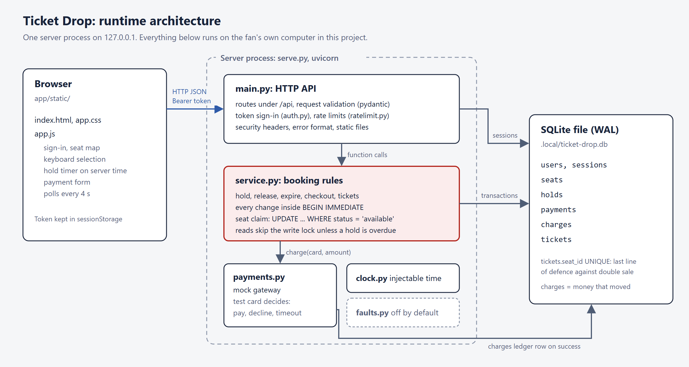
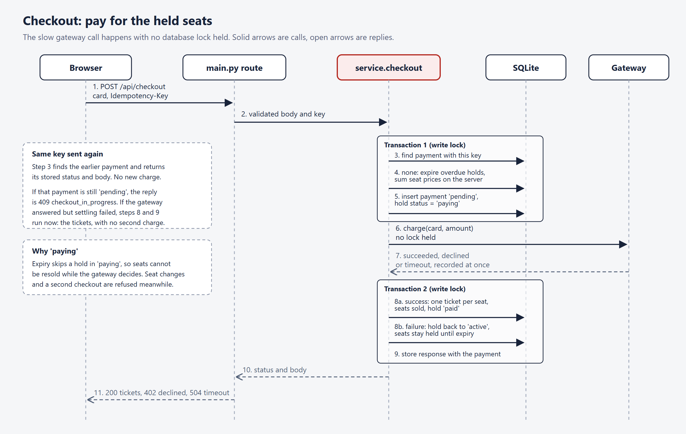

# Design (as built)

How version 1 of Ticket Drop actually works. The product contract is in [BRIEF.md](BRIEF.md). Choices and their alternatives are in [DECISIONS.md](DECISIONS.md).

## 1. Architecture

[Editable source](diagrams/ticket-drop-architecture.html)

| Component | File | Responsibility |
|---|---|---|
| Browser page | `app/static/index.html`, `app.css`, `app.js` | Sign-in, seat map, hold timer, payment form, My tickets. No framework |
| HTTP API | `app/main.py` | Routes, request validation, authentication, rate limits, security headers, error format, static files |
| Booking rules | `app/service.py` | Hold, release, expiry, checkout and tickets, each inside a database transaction |
| Sign-in | `app/auth.py` | Password check for seeded demo accounts, random session tokens stored as SHA-256 hashes |
| Rate limits | `app/ratelimit.py` | Token bucket per account for seat changes, sliding window per address for failed sign-ins |
| Mock gateway | `app/payments.py` | Decides the payment outcome from the test card and records successful charges |
| Clock | `app/clock.py` | The only source of time, so tests can stand on an exact millisecond |
| Database | `app/db.py` | Schema, connections, seed data, optional sample sales |
| Seeded faults | `app/faults.py` | Named deliberate bugs, all off unless enabled for an experiment |

The server listens on 127.0.0.1 only. One process owns one SQLite file in WAL mode.

## 2. One operation end to end: holding a seat

1. The fan clicks seat C-09. `toggleSeat` in `app.js` sends `POST /api/hold/seats` with `{"seat_id": "C-09"}` and the bearer token.
2. `main.py` validates the body against `SeatIn` (pattern `^[A-T]-\d{2}$`, no extra fields). A malformed body returns 422 before any rule runs.
3. The `limit_seat_changes` dependency resolves the account from the token (`auth.user_for_token`), then spends one token from that account's bucket. An empty bucket returns 429 with `Retry-After`.
4. `service.add_seat` opens `BEGIN IMMEDIATE`, which takes SQLite's write lock before reading anything.
5. Inside the transaction: expire overdue holds, refuse if the sale is not open, find the seat, find the fan's open hold, count held plus owned seats against the limit, create a hold if there is none (expiry = now + 300 s), then claim the seat with `UPDATE seats SET status = 'held', hold_id = ? WHERE id = ? AND status = 'available'`.
6. If that update changed no row, someone else has the seat: the transaction rolls back (including a hold created a moment earlier) and the API returns 409 `seat_taken`.
7. Otherwise the transaction commits and the response carries the hold and `server_now_ms`.
8. `app.js` records the difference between server time and local time, updates the stub, and the timer counts down from the server's `expires_ms`, not the laptop clock.

Why two protections against double booking: the write lock makes check-then-claim atomic, and the conditional update would still refuse a second claim if the locking were ever changed. `tickets.seat_id UNIQUE` is a third line for the final sale.

## 3. Checkout

[Editable source](diagrams/ticket-drop-checkout-sequence.html)

The gateway can be slow (the timeout card waits two seconds by default). Holding the write lock across that call would stop every other fan from claiming seats, so checkout runs in three steps:

1. **Reserve.** In one transaction: return the stored result if this account already used the idempotency key; otherwise compute the amount from the server's seat prices, insert a `pending` payment and set the hold to `paying`. Expiry skips `paying` holds.
2. **Charge.** Call the gateway with no transaction open, then immediately record its outcome on the payment row.
3. **Settle** (`settle_payment`). In a second transaction: on success, insert one ticket per seat, mark the seats sold and the hold paid; on decline or timeout, set the hold back to `active` so the seats stay held until their original expiry. Store the HTTP status and body on the payment row, so a repeated request with the same key returns exactly the same answer.

Settling is safe to repeat and retries briefly when the database is busy. If it still fails, the payment keeps its recorded outcome without a stored response, and the next request with the same key finishes the settle instead of charging again (DEF-007). A payment that began before the hold's expiry is honoured even if the gateway answers after it, because the seats were protected as `paying` throughout; a decline that arrives after the expiry frees the seats at once.

Idempotency keys are unique per account (`UNIQUE (user_id, idempotency_key)`), so one fan's key means nothing for another.

The browser generates a new key for each payment attempt but reuses it when a request gets no answer at all, because in that case it cannot know whether the first attempt was charged.

## 4. API

All responses are JSON, including unexpected server errors (500 `server_error`). Errors have one shape: `{"error": {"code": "...", "message": "..."}}`; `message` is written for the fan.

| Method and path | Auth | Success | Notable errors |
|---|---|---|---|
| `GET /api/event` | no | event, `sale_open`, `server_now_ms`, limits, prices | |
| `POST /api/login` | no | `{token, user}` | 401 `wrong_credentials`, 429 `too_many_attempts` |
| `POST /api/logout` | yes | 204 | 401 |
| `GET /api/me` | yes | username, display name | 401 |
| `GET /api/seats` | yes | 510 seats with `state` available, taken or mine | 401 |
| `GET /api/hold` | yes | the open hold or null | 401 |
| `POST /api/hold/seats` | yes | the hold | 409 `sale_not_open`, `seat_taken`, `limit_reached`, `checkout_in_progress`; 404 `seat_not_found`; 422; 429 |
| `DELETE /api/hold/seats/{seat_id}` | yes | the hold, or null if it was the last seat | 404 `seat_not_held`; 409 `checkout_in_progress`; 422; 429 |
| `DELETE /api/hold` | yes | 204 | 409 `checkout_in_progress`; 429 |
| `POST /api/checkout` + `Idempotency-Key` | yes | 200 payment and tickets | 400 `invalid_idempotency_key`; 402 `payment_declined`; 504 `payment_timeout`; 409 `no_hold`, `checkout_in_progress`; 422 |
| `GET /api/tickets` | yes | the fan's tickets | 401 |
| `GET /api/tickets/{id}` | yes | one ticket | 404 `ticket_not_found`, also for another fan's ticket |
| `POST /api/_test/clock` | no | new server time | exists only when `TICKET_DROP_TEST_HOOKS=1` |

The machine-readable schema is served at `/api/openapi.json`. The interactive documentation pages are switched off.

## 5. Data model

| Table | Key columns | Rules enforced by the database |
|---|---|---|
| `users` | username, display name, salt, PBKDF2 hash | username unique |
| `sessions` | SHA-256 of the token, user | |
| `seats` | id such as `C-09`, row, number, block, tier, price in cents, status, hold_id | status is available, held or sold; held if and only if hold_id is set |
| `holds` | user, created, expires, status | at most one `active` or `paying` hold per user (partial unique index) |
| `payments` | user, hold, idempotency key, amount, outcome, stored response | key unique per user |
| `charges` | payment, amount | the mock gateway's ledger: money that actually moved |
| `tickets` | user, seat, payment | seat unique |

Money is stored as whole cents in integers. The schema is created on first start; there are no migrations in version 1.

## 6. Time

Every rule that depends on time reads `Clock.now_ms()`. In tests the clock is frozen at a fixed instant and moved by exact amounts, which is how the 299 999 ms and 300 000 ms boundaries are tested. The live server exposes `/api/_test/clock` only when test hooks are switched on; a security test confirms the route does not exist by default.

## 7. Front end

Plain JavaScript in one file. The seat map is an SVG built from the API's row, number and block fields, laid out on arcs facing the stage. Seats are SVG elements with `role="button"`, an `aria-label` naming row, seat, category, price and state, and `aria-pressed` for held seats. Only one seat is in the tab order at a time; the arrow keys move between seats and Enter or Space holds or releases. The page refreshes the map every four seconds while visible. The content security policy allows only the site's own scripts and styles, so the page uses no inline script or style attributes.

The visual design follows the approved mockup: a cool grey page, navy ink, the three category colours of concert wristbands, Bahnschrift (a DIN-style face that ships with Windows), and one physical object, the ticket stub with its tear line and punched notches. On a phone the stub becomes a strip docked to the bottom with the timer and the Pay button.

## 8. Known limits

- One server process. The rate limiter keeps its counts in memory, so several processes would each allow the full rate.
- The seeded demo accounts share one password and one salt, so the expensive hash is computed once at seed time. Acceptable for demo accounts, not for real ones; bandit flags the hard-coded demo password, which is documented here on purpose.
- A process crash between the gateway charge and recording its outcome would leave a payment `pending` and a hold `paying`. Version 1 has no reconciliation job against the gateway. A failure after the outcome is recorded is recovered by a retry with the same key.
- Session tokens never expire. Acceptable for demo accounts only.
- Throughput is limited by CPU in one Python process; see DEF-002 in [DEFECTS.md](DEFECTS.md).
- Bahnschrift exists on Windows only. Other systems fall back to DIN Alternate, Arial Narrow or Arial.
- The session token is kept in `sessionStorage`, readable by any script on the page. The strict content security policy is the mitigation.
