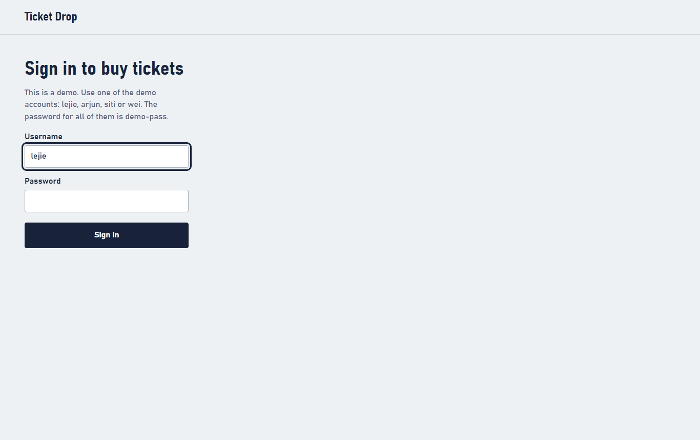
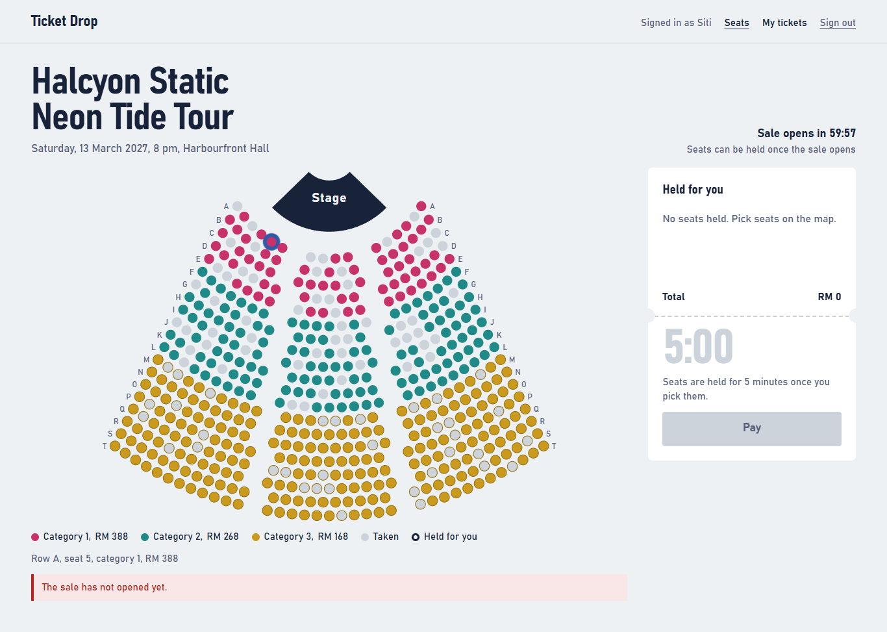
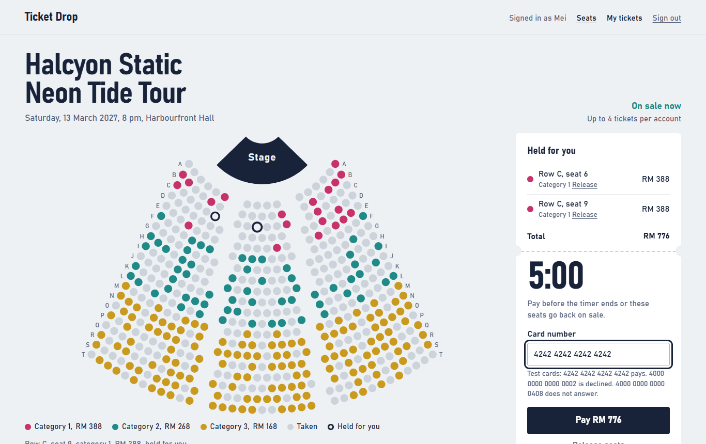
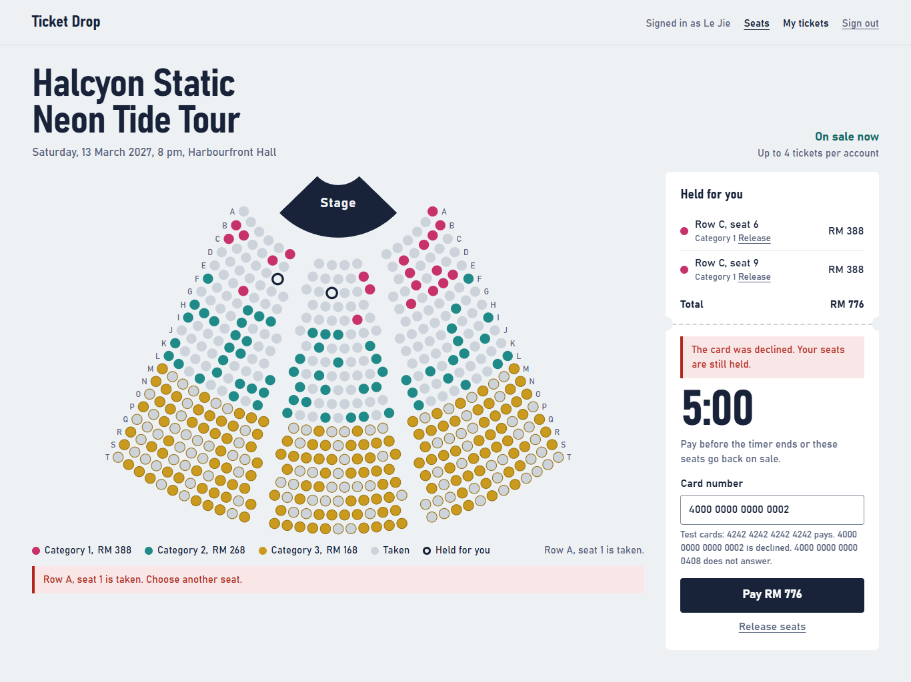
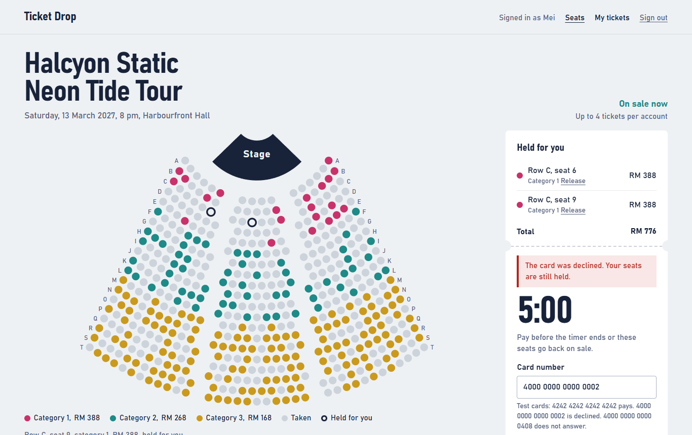
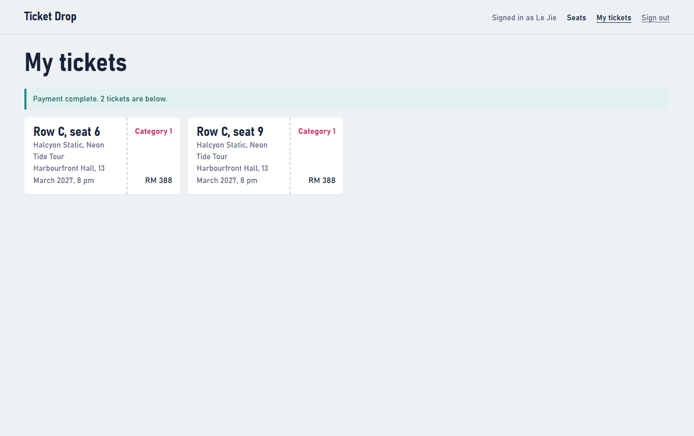
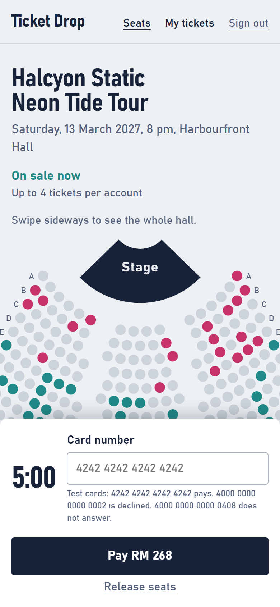

# Walkthrough

One fan's journey through Ticket Drop, screen by screen. The app has three views: sign-in, the seat map and My tickets. Most of the behaviour happens on the seat map, so most of this page is about its states.

To follow along, start the app as described in [Run it](../README.md#run-it). The screenshots were taken in Chrome at 1366 pixels wide, with about half the seats sold to sample accounts (`--sample-sales 0.55`), and the phone view at 390 pixels wide. `tools/capture_screenshots.py` recreates them.

## 1. Sign in

Use one of the demo accounts, `lejie`, `arjun`, `siti` or `wei`, with the password `demo-pass`. Each account is a separate fan, so two browser windows signed in as different accounts can compete for the same seats.

## 2. Before the sale opens

Started with `--sale-opens-in 3600`, the page counts down to the opening. The map can be explored, but picking a seat is refused with "The sale has not opened yet." The server makes that decision, not the page, so a fan cannot get ahead by changing the page.

## 3. Hold seats

Click a seat to hold it, or use the keyboard: Tab into the map, move with the arrow keys and press Enter or Space. Colours show the three price categories; grey seats are taken. Held seats appear on the right with the total and a five-minute timer that follows the server's clock.

Each account can have up to four tickets, counting seats it holds and tickets it already owns. To give a seat back, click it again or use Release.

## 4. Someone else was faster

Clicking a seat the map already shows as taken gives this message. If another fan claims a seat in the moment between the map's last refresh and the click, the server refuses it, saying the seat "has just been taken", and the page reads the map again straight away so the fan can choose another. Seats already held are not affected. (This screenshot also still shows the declined-card message from step 5, because it was taken right after it.)

## 5. A card is declined

Three test cards drive the mock payment gateway:

| Card | Result |
|---|---|
| `4242 4242 4242 4242` | Pays |
| `4000 0000 0000 0002` | Declined: "The card was declined. Your seats are still held." |
| `4000 0000 0000 0408` | Does not answer: "The payment service did not answer. You were not charged." |

After a decline the seats stay held, but the timer keeps running from the original hold; a failed payment does not buy extra time. If the hold runs out, the message says so and the fan chooses seats again.

## 6. Pay and see the tickets

With the paying card, each held seat becomes a ticket and the page moves to My tickets. A payment is never charged twice. A second press of Pay while a payment is in progress is ignored, and if the answer is lost on the way back, the retry sends the same idempotency key, so the server returns the first result instead of charging again. The [design document](DESIGN.md#3-checkout) shows how.

## 7. On a phone

On a narrow screen the map scrolls sideways and the hold and payment panel docks at the bottom. Tapping a held seat again releases it.
